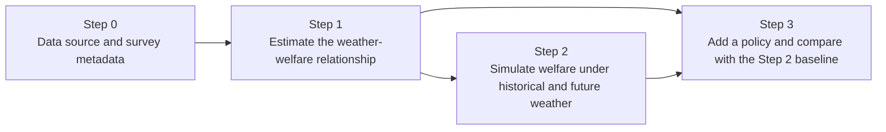

# Framework and identification

> WISE-APP estimates how local weather moves household welfare, applies that relationship to a fixed population under other weather, and then asks how a policy change would shift the result. Weather effects are identified from within-place variation in weather. Policy effects are not: they come from cross-sectional differences and are scenario arithmetic.

## Setup

The app answers three linked questions, one per step.

Symbols and indices are defined in [00_notation](00_notation.md).

## Method

### 1. Questions and estimands

| Step | Question | Estimand (the quantity the step is built to report) | Page |
|---|---|---|---|
| 1 | How does welfare respond to local weather, and for whom? | The coefficients on weather, $\beta$ (and $\gamma$ for differences between groups). For the quantile model, the effect of weather on a quantile of the welfare distribution, $\beta_\tau$. | [20_model_specification](20_model_specification.md) |
| 2 | What welfare distribution would this population face under other weather? | The distribution, across simulation years $r$, of a population statistic $T^{(r,s,m)}$ for a fixed baseline population. | [30_simulation](30_simulation.md) |
| 3 | How would a policy change that distribution? | The difference $\Delta T^{(r,s,m)}$ between policy and baseline under the same weather. | [40_policy_framework](40_policy_framework.md) |

The estimands are **stress tests**, not forecasts. Step 2 does not predict the welfare of the population in year $r$. It reports what welfare of today's population would be if year $r$'s weather occurred.

### 2. Counterfactual design

The design holds the population fixed and lets weather vary. Let $\mathcal{B}$ be the baseline survey sample, with units $i = 1,\dots,N$ and weights $\omega_i$. Their characteristics, fixed effects and (for the linear model) fitted residuals do not change across simulations. Only the weather changes. For a simulation year $r$, scenario $s$ and member $m$:

$$y_i^{*(r,s,m)} = \hat f\big(W_i^{(r,s,m)},\ M_i,\ X_i;\ \hat\beta,\hat\theta,\hat\gamma,\hat\delta,\hat\alpha,\hat\lambda\big) + \hat\varepsilon_i \qquad \text{(2.1)}$$

where $\hat f$ is the fitted prediction function of the chosen model and $\hat\varepsilon_i$ is the residual term chosen by the residual rule: the household's own residual, a resampled one, or none (see [30_simulation](30_simulation.md)). The quantile model uses no residual. It adds the predicted weather change to the household's observed baseline outcome instead (see [22_model_rif](22_model_rif.md)). The population statistic is

$$T^{(r,s,m)} = \mathcal{A}\Big(\big\lbrace (Y_i^{*(r,s,m)},\ \omega_i)\big\rbrace _{i \in \mathcal{B}}\Big), \qquad Y_i^{*(r,s,m)} = \exp\big(y_i^{*(r,s,m)}\big) \qquad \text{(2.2)}$$

Eq. (2.2) is written for a log outcome. A binary outcome has no back-transform.

Because $\mathcal{B}$ is the same in every simulated year, the spread of $T^{(r,s,m)}$ across $r$ shows the effect of weather variability alone. Differences between scenarios $s$ show the effect of a shift in the climate. Neither contains growth, migration or demographic change.

### 3. Identification of the weather response

Step 1 estimates Eq. (2.1) of [00_notation](00_notation.md) with area and time fixed effects. After the fixed effects are removed, the weather coefficients are identified from how much weather in a given interview differs from the typical weather in the same area and survey round. Whether weather enters as a level, an anomaly from the local normal, a standardised anomaly or bins, the identifying variation is the within-cell variation. The identifying condition is:

$$\mathbb{E}\big[\varepsilon_i \mid W_i,\ M_i,\ X_i,\ g(i),\ t(i)\big] = 0 \qquad \text{(3.1)}$$

In words: within an area and survey round, which households happened to be interviewed in a hotter or wetter month is unrelated to anything else that drives welfare. This is a design-based argument, not a test. It is plausible for weather because weather is not chosen by households, and it relies on the fixed effects to remove place-specific and round-specific confounders such as climate zone, market access and a national shock in the survey year.

Two features of the data limit this argument.

- **Spatial precision.** If a survey reports only coarse areas, households receive area-average weather. Local variation is smoothed away, which biases weather coefficients toward zero.
- **Temporal precision.** If a survey is fielded in a few months, or has no interview month, there is little within-cell variation to identify the effect.

Inference is clustered at the location panel, the level at which weather is assigned (see [20_model_specification](20_model_specification.md)).

### 4. Why policy coefficients are different

Policy variables $D_i$ (access to electricity, to a health facility, to a mobile phone, a level of education) are inputs to the same regression, but Eq. (3.1) does not protect their coefficients. A household with electricity differs from one without in many ways that the fixed effects do not remove: income, location within the area, preferences. The coefficient on $D$ and on its interaction with weather are therefore **associations** in the cross-section, not causal effects of extending access.

Step 3 uses them anyway, as scenario arithmetic. For the linear model, changing policy variables from $D_i$ to $D_i^{\text{pol}}$ shifts the prediction by

$$\Delta y_i = \hat\delta_D^{\prime}\ \Delta D_i + \hat\gamma_D^{\prime}\big(\Delta W_i^{(r,s,m)} \otimes \Delta D_i\big), \qquad \Delta D_i = D_i^{\text{pol}} - D_i, \qquad \Delta W_i^{(r,s,m)} = W_i^{(r,s,m)} - W_i^{0} \qquad \text{(4.1)}$$

where the first term is the level shift and the second term is the change in weather sensitivity, both read from the fitted model. The second term acts on the change in weather from the weather the household experienced at its interview, $W_i^{0}$ (see [40_policy_framework](40_policy_framework.md), Section 3). A cash transfer is added to the welfare level directly, instead of acting through a coefficient (see [42_social_protection](42_social_protection.md)). Eq. (4.1) is the linear-engine form of the decomposition into direct and resilience effects in [44_decomposition](44_decomposition.md).

The asymmetry follows from the design: the same fixed effects that make the weather channel credible are what leave the policy channel open to selection.

### 5. What kind of statement each step supports

| Statement | Supported? |
|---|---|
| "A hotter season lowers welfare by about $x$ per cent at this place." | Yes, if Eq. (3.1) holds and the weather is inside the estimated support. |
| "Under the weather of year $r$, the poverty rate of today's population would be $p$." | Yes, as a conditional prediction (Eq. 2.2). |
| "Under SSP 3-7.0 in 2030-2040, the poverty rate would be $p$." | Only for a population frozen at the baseline. It is a stress test of exposure. |
| "Giving every household electricity would raise welfare by $x$ per cent." | No. It is the cross-sectional gap between households with and without electricity, priced at the estimated coefficient. |
| "The policy reduces vulnerability to weather." | Only as far as the estimated weather-by-policy interaction is itself credible (see A4). |

## Interpretation

Read results in this order: (1) check that the estimation sample has within-place weather variation; (2) read the weather response; (3) read the baseline distribution and its bands as the exposure of today's population; (4) read policy results as the size of a scenario, with the assumption in A4 in mind.

## Assumptions

- **A1. Conditional exogeneity of weather.** Eq. (3.1): given the fixed effects and controls, weather is unrelated to unobserved determinants of welfare.
- **A2. Fixed population.** Every simulated year uses the baseline survey households with their observed characteristics. Population, assets, prices, wages, technology and behaviour do not change, and there is no feedback from welfare to markets.
- **A3. Stable response.** The relationship estimated on observed weather applies to the counterfactual weather, including weather outside the observed range. The further the scenario moves from the estimation support, the weaker the claim.
- **A4. Policy coefficients as scenario inputs.** The coefficient on a policy variable, and its interaction with weather, is applied as if it were the effect of changing that variable. It is a cross-sectional association (Section 4).
- **A5. Climate change enters as a change in monthly weather.** Future weather is the observed record shifted by the model-projected change in each month (see [31_climate_scenarios](31_climate_scenarios.md)). The scenario has the variance and day-to-day structure of the historical record.

## Limitations and what is not modelled

- Economic growth, structural change, migration, ageing and other demographic change.
- General-equilibrium effects: prices, wages and labour demand do not respond to weather or to policy.
- Adaptation by households or firms beyond what the survey already contains.
- Weather beyond the regressors in the model (for example compound events, or extremes that never occurred in the estimation sample).
- Service quality, delivery capacity and costs of policies other than the cash transfer.
- Indirect and economy-wide weather effects, since the model is estimated on local variation.

## In the app

- Step 0 > Overview: choose a data source.
- Step 1 > Sample, Outcome, Weather, Model, Results: estimation and its diagnostics.
- Step 2 > Simulation settings: baseline survey, historical window, scenarios.
- Step 3 > policy levers, Results, Diagnostics, Decomposition.

User guide: [Overview and limitations](https://github.com/worldbank/wise-app-docs/blob/main/index.qmd#limitations); [Identification asymmetry](https://github.com/worldbank/wise-app-docs/blob/main/step1.qmd#methodology-detail).

## References

[@auffhammer2013] on using weather variation and climate model output in economic analysis; [@cameronmiller2015], [@abadie2023] and [@moulton1990] on clustering at the level of treatment assignment. Full entries are in [references](references.md).

## Implementation map

| Concept | Equation | Code |
|---|---|---|
| Estimation of the weather-welfare model | (3.1) | `R/fct_step1_model.R` `wise_fit()` |
| Fixed baseline population, weather varied by year | (2.1), (2.2) | `R/fct_step2_compute.R` `step2_compute()`; `R/fct_run_simulation.R` |
| Policy change of the survey variables | (4.1) | `R/fct_policy_sim.R` `apply_policy_to_svy()` |
| Policy arm built from the baseline pipelines | (4.1) | `R/fct_step3_async.R` `step3_compute()` |
| Location-panel clustering | (3.1) | `R/fct_simulations.R` `COEF_VCOV_SPEC` |
